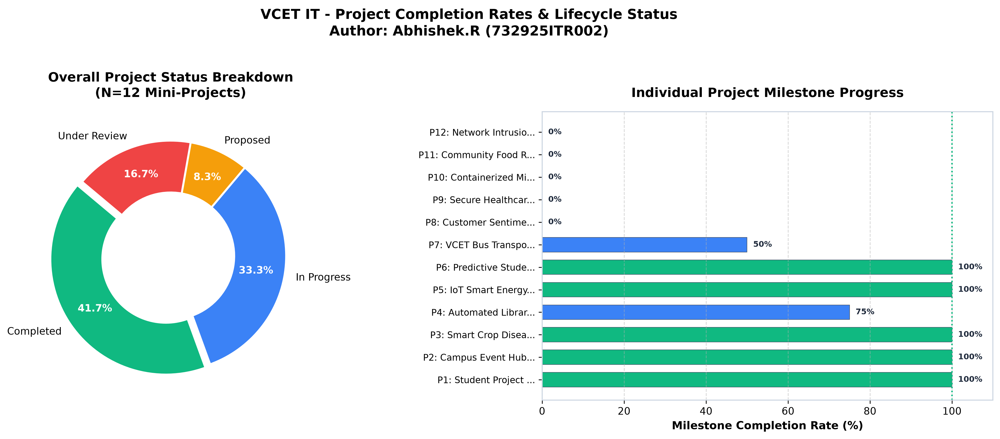
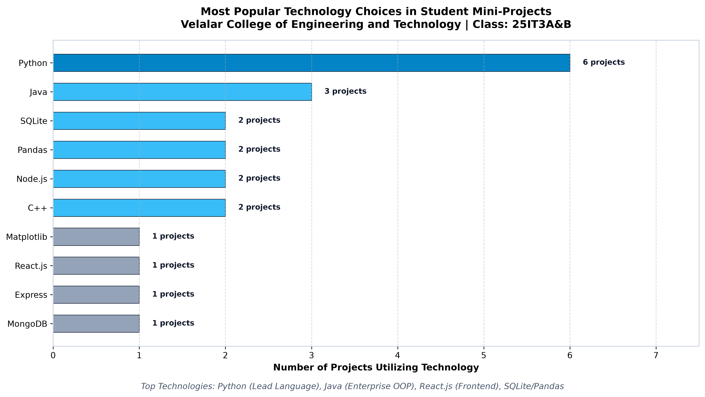
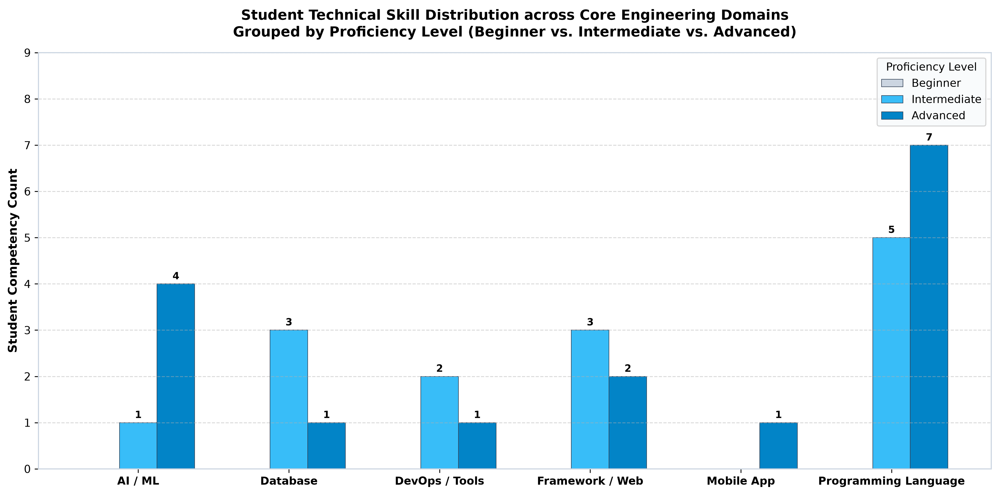
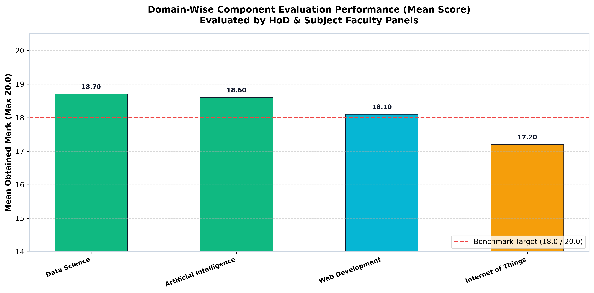

# VELALAR COLLEGE OF ENGINEERING AND TECHNOLOGY (AUTONOMOUS)
### DEPARTMENT OF INFORMATION TECHNOLOGY
### ACADEMIC YEAR: 2026 - 27 (ODD SEMESTER) | CLASS: 25IT3A&B
### ACTIVITY: PROJECT-BASED ASSESSMENT

---

# Student Project and Skill Tracking System
**Assigned Problem:** Scenario 2 (Register No.: 2, 32, 62, 92, L2)  
**Author / Student Name:** Abhishek.R  
**Register Number:** 732925ITR002  
**Class & Section:** 25IT3A (Section A)  
**Department:** Information Technology  

---

## 📌 Project Overview

In academic institutions, monitoring student mini-projects, competencies, and evaluation marks has traditionally been fragmented across disparate spreadsheets. This leads to information silos, inconsistent milestone tracking, difficulty in identifying technical skill gaps, and delayed departmental interventions.

The **Student Project and Skill Tracking System** resolves these challenges by providing a centralized, robust, and extensible platform that combines:
1. **A 3NF/BCNF Relational Database:** Enforcing data integrity across students, master technical skills, student competencies, project proposals, academic milestones, and rubric-based component evaluations.
2. **A Modular Java Application (OOP & JDBC):** Providing a clean, interactive menu-driven interface with automated milestone provisioning, input validation, and real-time skill gap detection.
3. **A Python Data Science Pipeline:** Directly extracting records from the database, executing data cleaning and wrangling, computing descriptive statistics, and generating publication-quality visual charts for departmental reviews.

---

## 🎓 Course Mapping & Syllabus Coverage

| Course Code | Course Title | Syllabus Units Covered | System Implementation Deliverables |
|:---|:---|:---|:---|
| **25ITT33** | **Software Engineering** | Units 1, 2, 3, 4 | SRS Document (IEEE 830), System Architecture, Use Case Modeling, Class Diagram, Sequence Diagrams, Testing Suite (Black-box & White-box test cases). |
| **25ITT31** | **Database Management Systems** | Units 1, 2, 3 | ER Diagram, Relational Schema, 1NF/2NF/3NF/BCNF Normalization, DDL/DML SQL scripts, Analytical Joins and Subqueries. |
| **25ITT32** | **Java Programming** | Units 1, 2, 3, 4, 5 | Modular OOP design, Model-DAO-Service architecture, Java JDBC connectivity, Collections framework, Exception handling, Console reporting. |
| **25ITC31** | **Foundations of Data Science** | Units 1, 2, 3, 4, 5 | Data retrieval via `sqlite3`, missing value treatment, feature engineering (`progress_pct`), descriptive metrics (mean, std dev), Matplotlib visual charts. |

---

## 📂 Repository Directory Layout

```
d:\project 1\
├── docs\                               # Software Engineering & DBMS Documentation
│   ├── SRS.md                          # IEEE-830 Software Requirements Specification
│   ├── SYSTEM_DESIGN.md                # System Architecture, UML Use Case, Class & Sequence Diagrams
│   ├── DATABASE_DESIGN.md              # ER Diagram, Relational Model & 3NF/BCNF Normalization
│   └── TESTING_DOCUMENT.md             # Verification & Validation: 19 Black/White-box Test Cases
├── database\                           # Relational Database Storage & Scripts
│   ├── schema.sql                      # DDL Schema Definition (Tables, Constraints, Indexes)
│   ├── seed_data.sql                   # Realistic Seed Dataset (Students, Skills, Projects, Marks)
│   ├── setup_database.py               # Automated Database Initializer Script
│   └── tracking_system.db              # Pre-populated SQLite Relational Database
├── java_app\                           # Java Application Source Code (JDK 17+)
│   ├── src\com\vcet\tracking\
│   │   ├── Main.java                   # Interactive CLI Console Application & Auto-demo
│   │   ├── model\                      # Domain Entity Classes
│   │   │   ├── Student.java
│   │   │   ├── Skill.java
│   │   │   ├── Project.java
│   │   │   ├── Milestone.java
│   │   │   └── Evaluation.java
│   │   ├── dao\                        # Data Access Objects (JDBC)
│   │   │   ├── DatabaseConnection.java
│   │   │   ├── StudentDAO.java
│   │   │   ├── ProjectDAO.java
│   │   │   └── EvaluationDAO.java
│   │   └── service\                    # Business Logic & Formatted Reports
│   │       ├── TrackingService.java
│   │       └── ReportGenerator.java
│   ├── bin\                            # Compiled Java Bytecode (.class files)
│   ├── lib\                            # SQLite JDBC Driver and SLF4J dependencies
│   ├── compile.bat                     # Windows Batch Script to Compile Java
│   └── run.bat                         # Windows Batch Script to Run Java Application
├── python_ds\                          # Foundations of Data Science (Python)
│   ├── data_retrieval_and_analysis.py  # Data extraction, cleaning, and summary metrics
│   ├── generate_visualizations.py      # Matplotlib Visual Chart Generator
│   ├── data_analysis.ipynb             # Structured Jupyter Notebook (Units 1 - 5)
│   ├── clean_projects.csv              # Exported Clean Preprocessed Projects Dataset
│   ├── clean_skills.csv                # Exported Clean Preprocessed Skills Dataset
│   ├── clean_evaluations.csv           # Exported Clean Preprocessed Evaluations Dataset
│   └── visualizations\                 # High-Resolution Publication Charts
│       ├── 1_project_completion_rates.png
│       ├── 2_popular_technology_choices.png
│       ├── 3_student_skill_distribution.png
│       └── 4_domain_wise_marks_performance.png
├── sample_io\                          # Sample Inputs and Captured Outputs
│   ├── sample_inputs.txt               # Step-by-step menu input sequences
│   └── sample_outputs.txt              # Captured terminal execution outputs
└── README.md                           # Master Project Documentation & Execution Guide
```

---

## 📊 Data Science Visualizations & Findings

All charts are dynamically generated from `tracking_system.db` via Python and stored in `python_ds/visualizations/`:

### 1. Project Completion Rates & Lifecycle Status

* **Insights:** 41.7% of projects have achieved 100% milestone delivery, with 33.3% actively in progress and 16.7% undergoing evaluation review.

### 2. Popular Technology Choices Across Mini-Projects

* **Insights:** Python leads student adoption (utilized in 50% of projects), followed by Java and React.js for enterprise and web applications.

### 3. Student Technical Skill Distribution by Category & Proficiency

* **Insights:** High competency is observed in Core Programming and Data Science libraries, while Cloud Computing and DevOps represent key areas for faculty workshops.

### 4. Domain-Wise Evaluation Marks Performance

* **Insights:** Mean assessment scores across all domains exceed the departmental benchmark target of 18.0 / 20.0 (90%), with Data Science and AI projects leading performance.

---

## 🛠️ Technology Stack

* **Programming Languages:** Java (JDK 26 / JDK 17+ compatible), Python 3.10+
* **Database Engine:** SQLite 3.x (Zero configuration, embedded file storage) & ANSI SQL (MySQL 8.0 compatible)
* **Connectivity & Libraries:** Java JDBC, SQLite JDBC Driver (`sqlite-jdbc.jar`), SLF4J, Python `sqlite3`, `matplotlib`, `csv`
* **Modeling & Documentation:** Mermaid UML Diagrams, IEEE 830 Standards, Markdown
* **Operating Environment:** Windows / Linux / macOS

---

## 🚀 Execution Instructions

### Prerequisites
* JDK 17 or higher (`javac` and `java` in PATH)
* Python 3.10 or higher (`python` in PATH)

---

### Step 1: Initialize Database (DBMS Setup)
To build and seed the SQLite database from SQL scripts, execute:
```bash
python database/setup_database.py
```
*Output: Creates `database/tracking_system.db` with 12 students, 15 skills, 30 skill mappings, 12 projects, 27 milestones, and 25 evaluation records.*

---

### Step 2: Compile & Execute Java Application

#### Option A: Using Windows Batch Scripts (Quickest)
* To compile: Double-click `java_app/compile.bat` or run:
  ```cmd
  cd java_app
  compile.bat
  ```
* To run interactive console: Double-click `java_app/run.bat` or run:
  ```cmd
  cd java_app
  run.bat
  ```

#### Option B: Manual Command Line Execution
```bash
# Compile
javac -cp "java_app/lib/*" -d java_app/bin java_app/src/com/vcet/tracking/model/*.java java_app/src/com/vcet/tracking/dao/*.java java_app/src/com/vcet/tracking/service/*.java java_app/src/com/vcet/tracking/*.java

# Run Interactive Menu
java -cp "java_app/bin;java_app/lib/*" com.vcet.tracking.Main

# Run Automated Verification Demo
java -cp "java_app/bin;java_app/lib/*" com.vcet.tracking.Main --demo
```

---

### Step 3: Run Python Data Analytics & Visualizations

```bash
# 1. Run Data Retrieval, Wrangling & Summary Statistics
python python_ds/data_retrieval_and_analysis.py

# 2. Generate and Update Publication Charts
python python_ds/generate_visualizations.py
```

---

## 🧪 Testing Summary

The project underwent comprehensive Black-Box (Equivalence Partitioning, Boundary Value Analysis) and White-Box (Basis Path Testing with Cyclomatic Complexity $V(G)=3$) evaluations:
* **Total Test Cases Executed:** 19
* **Test Cases Passed:** 19 (100%)
* **Detailed Report:** Refer to [TESTING_DOCUMENT.md](docs/TESTING_DOCUMENT.md)

---

## 👤 Author Information

* **Student Name:** Abhishek.R
* **Register Number:** 732925ITR002
* **Class:** 25IT3A
* **Section:** Section A
* **Department:** Information Technology
* **College:** Velalar College of Engineering and Technology (Autonomous), Erode - 638012
* **Academic Year:** 2026 - 27 (ODD Semester)
