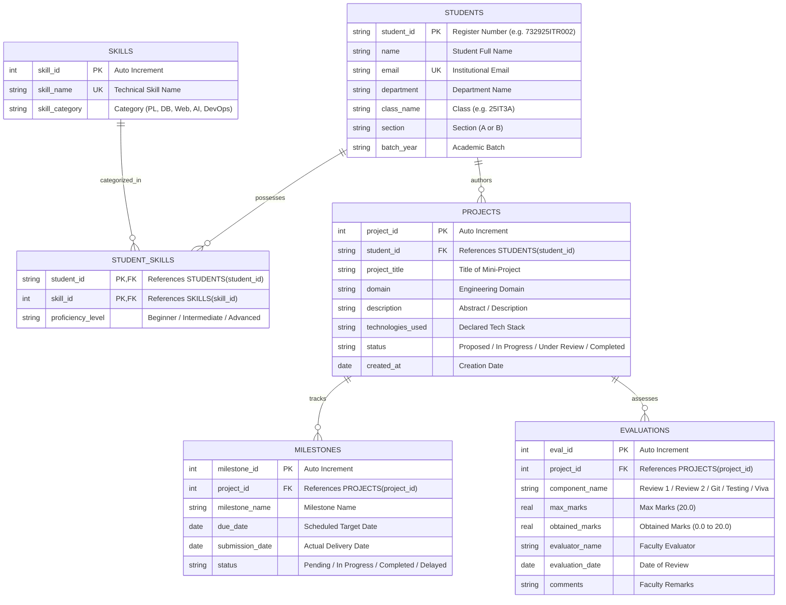

# DATABASE DESIGN & NORMALIZATION SPECIFICATION
## Student Project and Skill Tracking System

---

**Institution:** Velalar College of Engineering and Technology (Autonomous), Erode - 638012  
**Department:** Department of Information Technology  
**Academic Year:** 2026 - 27 (ODD Semester) | **Class:** 25IT3A&B  
**Author / Student Name:** Abhishek.R  
**Register Number:** 732925ITR002  
**Class & Section:** 25IT3A (Section A)  
**Course Code & Title:** 25ITT31 - Database Management Systems  

---

## 1. Entity-Relationship (ER) Diagram

The system database model structures students, skills, projects, milestones, and component evaluations:



---

## 2. Relational Model & Schema Specification

The relational data model consists of 6 normalized relation schemas:

1. **`students`**  
   $\text{students}(\underline{\text{student\_id}}, \text{name}, \text{email}, \text{department}, \text{class\_name}, \text{section}, \text{batch\_year})$  
   * **Primary Key:** `student_id`  
   * **Alternate / Candidate Key:** `email`

2. **`skills`**  
   $\text{skills}(\underline{\text{skill\_id}}, \text{skill\_name}, \text{skill\_category})$  
   * **Primary Key:** `skill_id`  
   * **Candidate Key:** `skill_name`

3. **`student_skills`**  
   $\text{student\_skills}(\underline{\text{student\_id}}, \underline{\text{skill\_id}}, \text{proficiency\_level})$  
   * **Composite Primary Key:** $(\text{student\_id}, \text{skill\_id})$  
   * **Foreign Key 1:** $\text{student\_id} \rightarrow \text{students}(\text{student\_id})\text{ ON DELETE CASCADE}$  
   * **Foreign Key 2:** $\text{skill\_id} \rightarrow \text{skills}(\text{skill\_id})\text{ ON DELETE CASCADE}$

4. **`projects`**  
   $\text{projects}(\underline{\text{project\_id}}, \text{student\_id}, \text{project\_title}, \text{domain}, \text{description}, \text{technologies\_used}, \text{status}, \text{created\_at})$  
   * **Primary Key:** `project_id`  
   * **Foreign Key:** $\text{student\_id} \rightarrow \text{students}(\text{student\_id})\text{ ON DELETE CASCADE}$

5. **`milestones`**  
   $\text{milestones}(\underline{\text{milestone\_id}}, \text{project\_id}, \text{milestone_name}, \text{due\_date}, \text{submission\_date}, \text{status})$  
   * **Primary Key:** `milestone_id`  
   * **Foreign Key:** $\text{project\_id} \rightarrow \text{projects}(\text{project\_id})\text{ ON DELETE CASCADE}$

6. **`evaluations`**  
   $\text{evaluations}(\underline{\text{eval\_id}}, \text{project\_id}, \text{component\_name}, \text{max\_marks}, \text{obtained\_marks}, \text{evaluator\_name}, \text{evaluation\_date}, \text{comments})$  
   * **Primary Key:** `eval_id`  
   * **Foreign Key:** $\text{project\_id} \rightarrow \text{projects}(\text{project\_id})\text{ ON DELETE CASCADE}$

---

## 3. Database Normalization Analysis (1NF to BCNF)

### 3.1 Initial Unnormalized State (Spreadsheet Representation)
Prior to this system, student records, project milestones, skills, and marks were kept in flat spreadsheet tables:
$$\text{UNF\_TRACKING}(\text{RegNo}, \text{Name}, \text{Skills}, \text{ProjectTitle}, \text{Domain}, \text{Milestones}, \text{Reviews}, \text{Marks})$$
* **Issues:**
  * **Repeating Groups:** Multiple skills and multiple milestones in single cells.
  * **Insertion Anomalies:** Cannot record a new skill without registering a student and project.
  * **Update Anomalies:** Updating student email requires modifying multiple project rows.
  * **Deletion Anomalies:** Deleting a project deletes the student's entire profile.

---

### 3.2 First Normal Form (1NF)
> **Definition:** A relation $R$ is in 1NF if and only if the domain of each attribute contains only atomic (indivisible) values, and there are no repeating groups.

* **Transformation:**
  * Disaggregated multivalued attributes (`Skills`, `Milestones`, `Reviews`) into dedicated relations.
  * Ensured each attribute holds single atomic values.
  * Defined primary keys for all tables.

---

### 3.3 Second Normal Form (2NF)
> **Definition:** A relation is in 2NF if it is in 1NF and every non-prime attribute is fully functionally dependent on the entire primary key (no partial dependencies).

* **Examination of Composite Key Table (`student_skills`):**
  * Composite Primary Key: $(\text{student\_id}, \text{skill\_id})$
  * Functional Dependency: $(\text{student\_id}, \text{skill\_id}) \rightarrow \text{proficiency\_level}$
  * Notice that `skill_name` and `skill_category` depend only on `skill_id`, NOT on `student_id`.
* **Resolution:**
  * Extracted `skill_name` and `skill_category` into the independent master entity `skills`.
  * Preserved only $\text{proficiency\_level}$ in `student_skills`.
  * **Conclusion:** 2NF is satisfied across all tables.

---

### 3.4 Third Normal Form (3NF)
> **Definition:** A relation is in 3NF if it is in 2NF and no non-prime attribute is transitively dependent on the primary key (no $X \rightarrow Y$ and $Y \rightarrow Z$ where $Z$ is non-prime).

* **Examination of `projects` Table:**
  * Primary Key: `project_id`
  * Candidate Dependency: $\text{project\_id} \rightarrow \text{student\_id}$, and $\text{student\_id} \rightarrow (\text{name}, \text{email})$.
  * If student details were stored inside `projects`, `name` and `email` would be transitively dependent on `project_id`.
* **Resolution:**
  * Student attributes are isolated in `students`.
  * `projects` references only the foreign key `student_id`.
  * Every determinant in `projects`, `milestones`, and `evaluations` is a candidate key.
  * **Conclusion:** 3NF is strictly achieved.

---

### 3.5 Boyce-Codd Normal Form (BCNF)
> **Definition:** A relation $R$ is in BCNF if for every functional dependency $X \rightarrow Y$, $X$ is a superkey of $R$.

* **Verification:**
  1. In `students`: $\text{student\_id} \rightarrow \text{All Attributes}$ (`student_id` is Superkey); $\text{email} \rightarrow \text{All Attributes}$ (`email` is Superkey).
  2. In `skills`: $\text{skill\_id} \rightarrow \text{All Attributes}$; $\text{skill\_name} \rightarrow \text{skill\_category}$.
  3. In `projects`: $\text{project\_id} \rightarrow \text{All Attributes}$.
  4. In `milestones`: $\text{milestone\_id} \rightarrow \text{All Attributes}$.
  5. In `evaluations`: $\text{eval\_id} \rightarrow \text{All Attributes}$.
  6. In `student_skills`: $(\text{student\_id}, \text{skill\_id}) \rightarrow \text{proficiency\_level}$.
* **Conclusion:** All functional dependencies satisfy BCNF.

---

## 4. Key Analytical SQL Queries

### Query 1: Student Project Progress & Completion Calculation
```sql
SELECT 
    p.project_id,
    p.student_id,
    s.name AS student_name,
    p.project_title,
    p.domain,
    p.status,
    COUNT(m.milestone_id) AS total_milestones,
    SUM(CASE WHEN m.status = 'Completed' THEN 1 ELSE 0 END) AS completed_milestones,
    ROUND((SUM(CASE WHEN m.status = 'Completed' THEN 1.0 ELSE 0.0 END) / COUNT(m.milestone_id)) * 100.0, 1) AS progress_percentage
FROM projects p
JOIN students s ON p.student_id = s.student_id
LEFT JOIN milestones m ON p.project_id = m.project_id
GROUP BY p.project_id
ORDER BY progress_percentage DESC;
```

### Query 2: Aggregate Assessment Score per Project (Max 100)
```sql
SELECT 
    p.project_id,
    s.name AS student_name,
    p.project_title,
    COUNT(e.eval_id) AS components_evaluated,
    SUM(e.obtained_marks) AS total_obtained_marks,
    SUM(e.max_marks) AS total_max_marks,
    ROUND((SUM(e.obtained_marks) / SUM(e.max_marks)) * 100.0, 2) AS aggregate_percentage
FROM projects p
JOIN students s ON p.student_id = s.student_id
JOIN evaluations e ON p.project_id = e.project_id
GROUP BY p.project_id
ORDER BY total_obtained_marks DESC;
```

### Query 3: Skill Proficiency Matrix by Engineering Category
```sql
SELECT 
    sk.skill_category,
    sk.skill_name,
    SUM(CASE WHEN ss.proficiency_level = 'Beginner' THEN 1 ELSE 0 END) AS beginner_count,
    SUM(CASE WHEN ss.proficiency_level = 'Intermediate' THEN 1 ELSE 0 END) AS intermediate_count,
    SUM(CASE WHEN ss.proficiency_level = 'Advanced' THEN 1 ELSE 0 END) AS advanced_count,
    COUNT(ss.student_id) AS total_students
FROM skills sk
LEFT JOIN student_skills ss ON sk.skill_id = ss.skill_id
GROUP BY sk.skill_id
ORDER BY sk.skill_category, total_students DESC;
```
