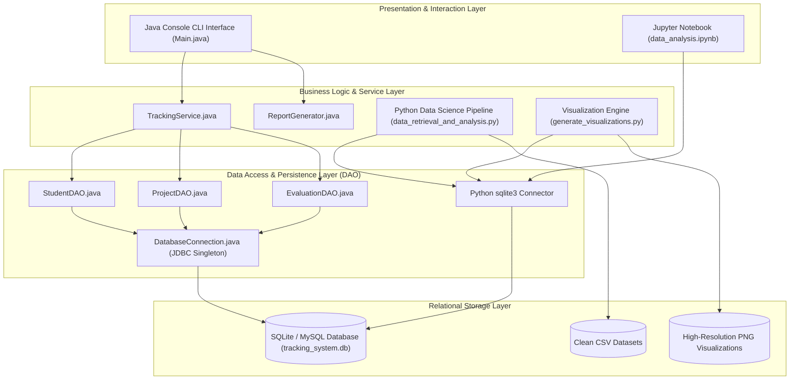
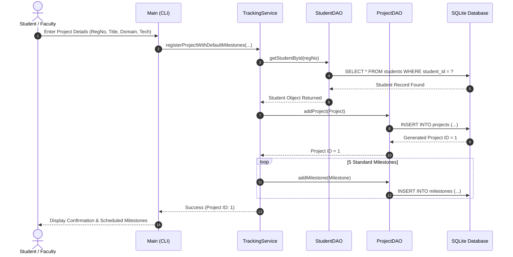
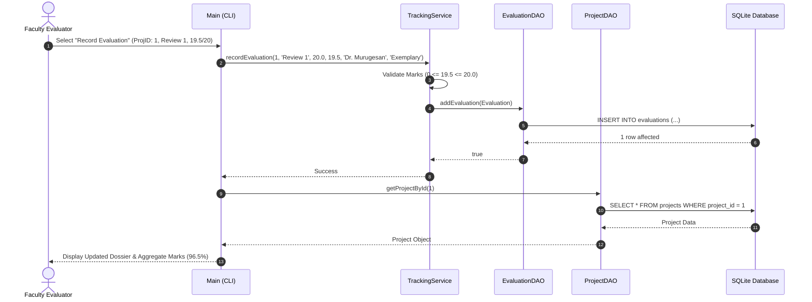
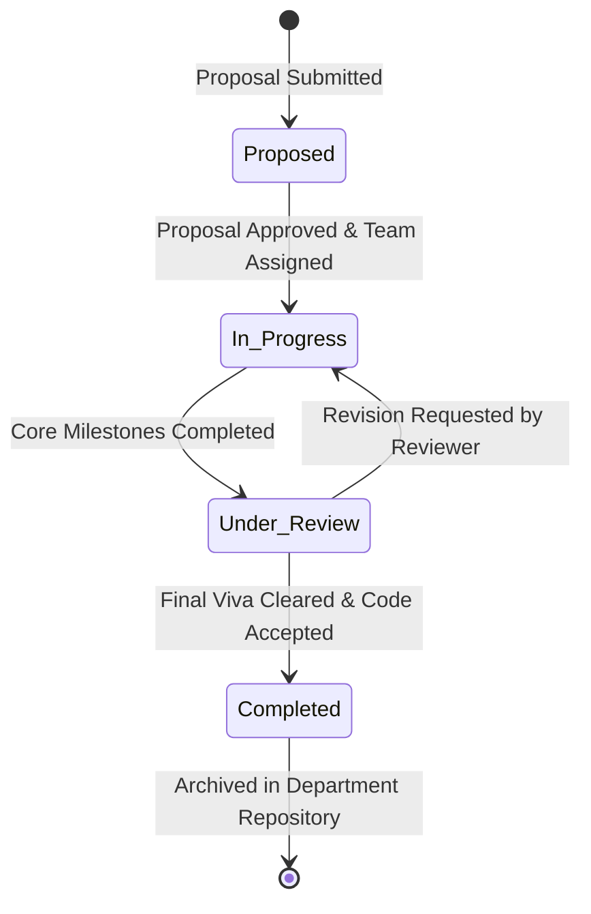
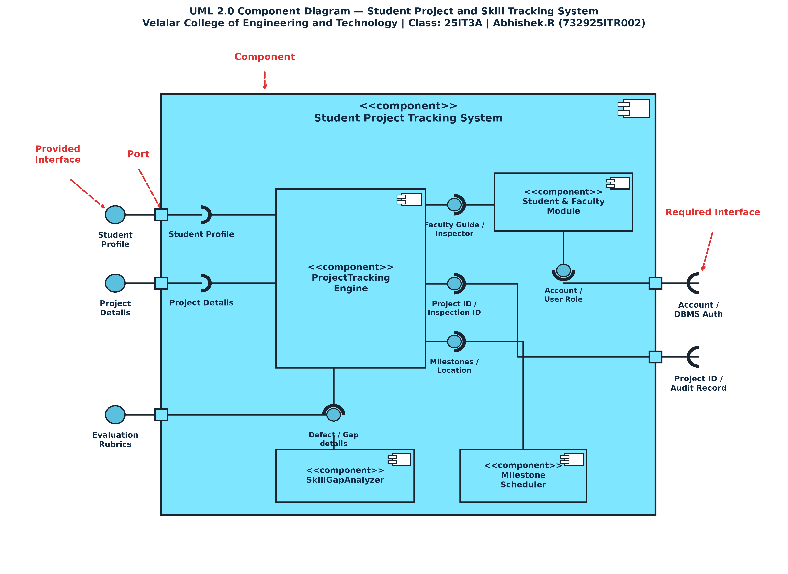
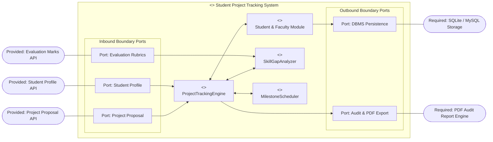
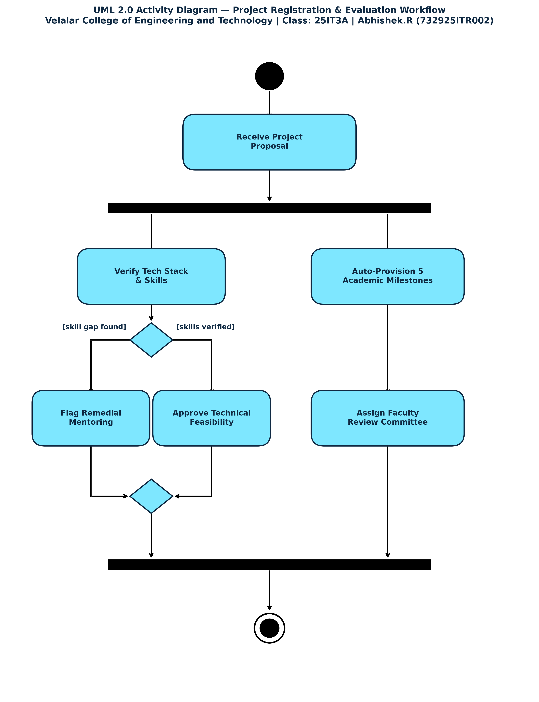
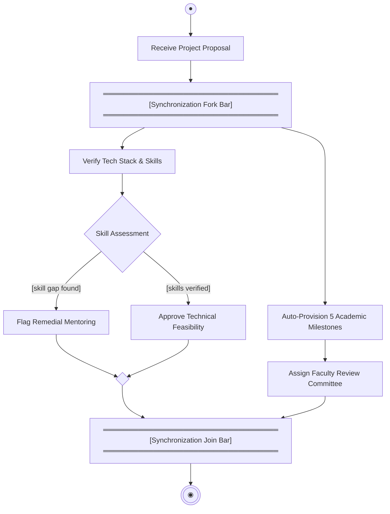

# SYSTEM DESIGN & ARCHITECTURE DOCUMENT
## Student Project and Skill Tracking System

---

**Institution:** Velalar College of Engineering and Technology (Autonomous), Erode - 638012  
**Department:** Department of Information Technology  
**Academic Year:** 2026 - 27 (ODD Semester) | **Class:** 25IT3A&B  
**Author / Student Name:** Abhishek.R  
**Register Number:** 732925ITR002  
**Class & Section:** 25IT3A (Section A)  
**Course Code & Title:** 25ITT33 - Software Engineering  

---

## 1. System Architecture Design

The system implements a decoupled, 3-tier enterprise architecture ensuring separation of concerns, high maintainability, and data security:

### Architectural Tier Breakdown
1. **Presentation Layer:**
   - Provides user interactions through a structured menu with ANSI formatting.
   - Accepts user commands, validates immediate formats, and delegates processing to service classes.
2. **Business Logic Layer:**
   - Enforces academic validation rules, automated milestone generation, skill gap detection, and progress metric computation.
   - The Python component performs data wrangling, descriptive statistics, and chart generation.
3. **Data Access Layer (DAO Pattern):**
   - Encapsulates all SQL statement executions, connection lifecycle management, and Object-Relational mapping (`ResultSet` to Java POJOs).
4. **Relational Storage Layer:**
   - Enforces relational constraints (PK, FK, CHECK constraints, Unique indexes).

---

## 2. Use Case Modeling

### 2.1 Use Case Diagram

### 2.2 Detailed Use Case Specifications

#### Use Case UC-02: Submit Project Proposal
* **Primary Actor:** Student
* **Pre-conditions:** Student must be registered in the system with a valid Register Number.
* **Main Success Scenario:**
  1. Student selects "Register New Student Project" from the menu.
  2. System prompts for Register Number, Title, Domain, Abstract, and Technologies Used.
  3. System verifies student existence in the database.
  4. System validates that the selected domain is an approved engineering domain.
  5. System records project record with initial status `In Progress`.
  6. System automatically provisions 5 standard academic milestones with scheduled deadlines.
  7. System displays success confirmation and assigned Project ID.
* **Post-conditions:** Project and 5 milestones are committed in the database.

#### Use Case UC-05: Record Component Evaluation Marks
* **Primary Actor:** Faculty Reviewer / HoD
* **Pre-conditions:** Project must exist in the database.
* **Main Success Scenario:**
  1. Faculty inputs Project ID.
  2. System displays current project details and milestone progress.
  3. Faculty selects component (Review 1, Review 2, Code Quality, Testing, Viva).
  4. Faculty inputs obtained marks, faculty name, and remarks.
  5. System validates: $0 \le \text{Obtained Marks} \le \text{Max Marks}$.
  6. System stores evaluation record and updates aggregate project performance.
* **Post-conditions:** Evaluation marks are logged and available for report generation.

---

## 3. Class Diagram (Object-Oriented Modeling)

The class diagram demonstrates clean adherence to **25ITT32 (Java Programming)** principles: encapsulation with private fields, typed collections, separation of concerns using the DAO design pattern, and cohesive service orchestration.

---

## 4. Sequence Diagrams

### 4.1 Project Registration & Milestone Attachment Sequence

### 4.2 Component Evaluation & Scoring Sequence

---

## 5. State Transition Model for Project Lifecycle

---

## 6. UML 2.0 Component Diagram

The UML Component Diagram models the modular runtime organization and wiring of the **Student Project and Skill Tracking System**, conforming to IEEE/ISO component-based software engineering standards.

### 6.1 Component & Interface Specification Table

| Element Type | Notation & Symbol | Identifier | Role & Function in System |
|:---|:---|:---|:---|
| **Subsystem Container** | `<<component>>` Large Rectangle | `Student Project Tracking System` | Encapsulates internal business logic and hides implementation details from external actors. |
| **Central Core Component** | `<<component>>` Center Box | `ProjectTrackingEngine` | Coordinates project proposals, milestone validation, evaluation computations, and data queries. |
| **Auxiliary Component** | `<<component>>` Top-Right Box | `Student & Faculty Module` | Manages student profiles, technical skills taxonomy, faculty mentor allocations, and user roles. |
| **Auxiliary Component** | `<<component>>` Bottom-Left Box | `SkillGapAnalyzer` | Detects deficiencies between student proficiency levels and required project tech stacks. |
| **Auxiliary Component** | `<<component>>` Bottom-Right Box | `MilestoneScheduler` | Provisions 5 default academic milestones and computes completion percentages. |
| **Boundary Port** | Small Square `[ ]` on Border | `Port (Left & Right)` | Explicit interaction point mediating communication between external interfaces and internal logic. |
| **Provided Interface** | Lollipop / Ball `—(O)` | `Student Profile`, `Project Details`, `Evaluation Rubrics` | Services, APIs, and data models supplied by the system for clients, students, and faculty. |
| **Required Interface** | Socket / Arc `—(C)` | `Account / DBMS Auth`, `Project ID / Audit Record` | Services demanded by the system from external subsystems (e.g., SQLite engine, PDF export engine). |
| **Assembly Connector** | Ball-and-Socket `—(O—(C—` | `Faculty Guide`, `Milestones`, `Defect/Gap details`, `User Role` | Runtime binding linking a provided interface of one component directly to the required interface of another. |

### 6.2 Component Wiring & Data Flow (Mermaid Equivalent)

---

## 7. UML 2.0 Activity Diagram

The UML Activity Diagram defines the parallel control flow and business process logic governing **Project Registration & Evaluation Workflow**, utilizing concurrent fork-join synchronization, conditional branch guards, and activity final termination.

### 7.1 Workflow State & Decision Logic Breakdown

1. **Initial Node (`●`):** The workflow initiates when a student submits a new mini-project proposal.
2. **Action State (`Receive Project Proposal`):** The system parses student credentials, project title, domain classification, abstract, and declared tech stack.
3. **Synchronization Fork Bar (Thick Horizontal Bar):** The execution thread branches concurrently into two independent parallel processing pipelines:
   - **Branch 1: Technical Stack & Competency Verification:**
     - **Action (`Verify Tech Stack & Skills`):** Queries student's recorded competencies against the declared technologies.
     - **Decision Diamond (`Condition Check`):**
       - `[skill gap found]`: Routes to **`Flag Remedial Mentoring`**, alerting the faculty mentor and scheduling tutorial milestones.
       - `[skills verified]`: Routes to **`Approve Technical Feasibility`**, confirming direct competency alignment.
     - **Merge Diamond:** Merges the conditional pathways back into a unified technical approval status.
   - **Branch 2: Academic Governance & Milestone Setup:**
     - **Action (`Auto-Provision 5 Academic Milestones`):** Generates standard academic deliverables (SRS, UML Design, Implementation, Analytics, Final Viva) with due dates.
     - **Action (`Assign Faculty Review Committee`):** Maps departmental evaluators and assigns assessment rubrics.
4. **Synchronization Join Bar (Thick Horizontal Bar):** Waits for both the technical competency analysis and the administrative milestone scheduling to complete successfully.
5. **Activity Final Node (`◉` Bullseye):** Commits the project record into `database/tracking_system.db`, marks initial status as `In Progress`, and issues confirmation to the student.

### 7.2 Activity Flow Modeling (Mermaid Equivalent)

