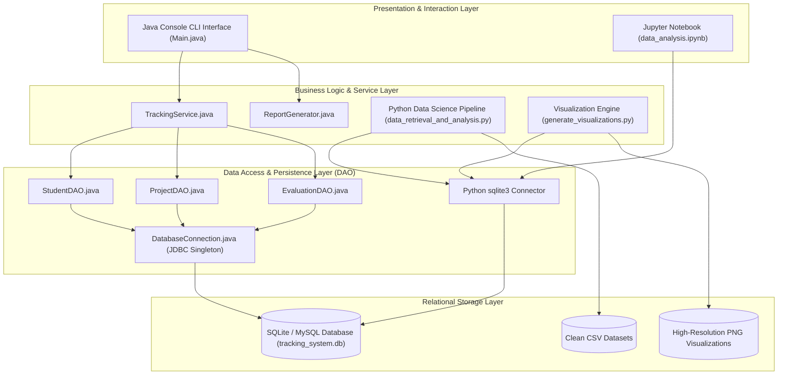
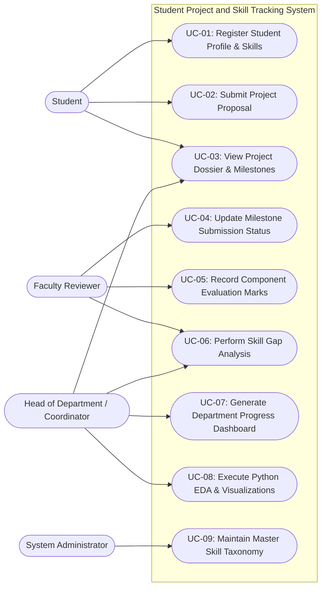
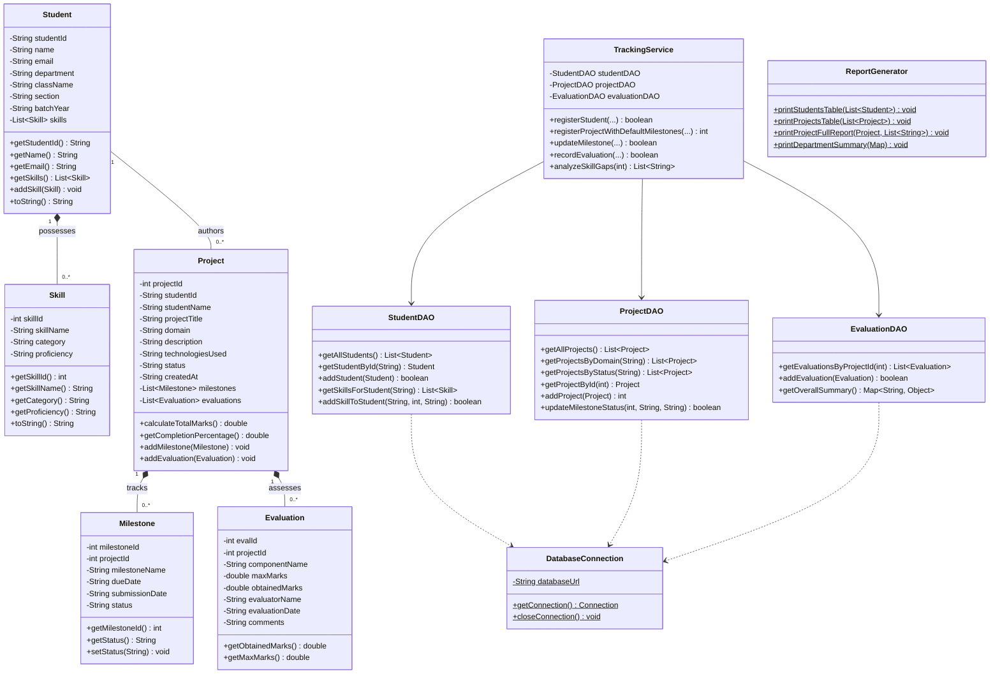
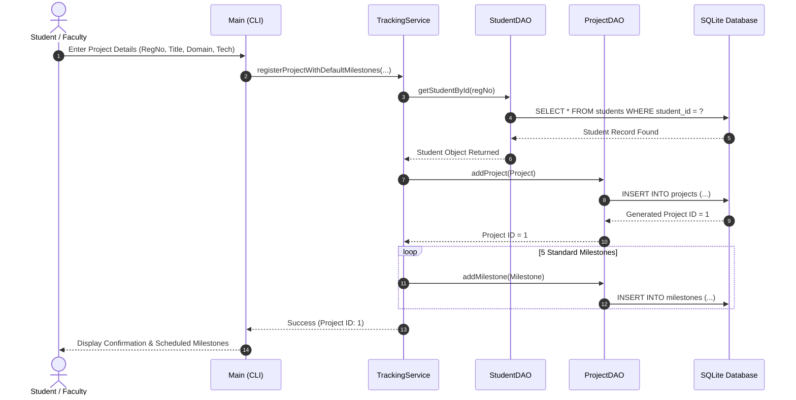
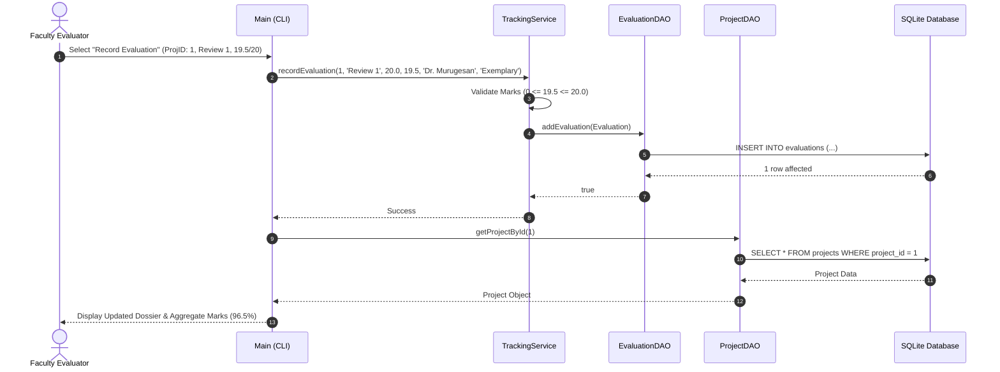
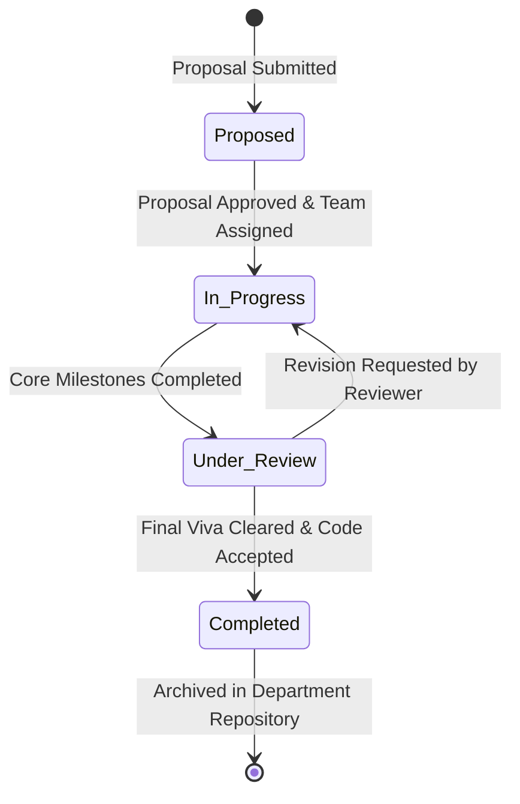

# SYSTEM DESIGN & ARCHITECTURE DOCUMENT
## Student Project and Skill Tracking System

---

**Institution:** Velalar College of Engineering and Technology (Autonomous), Erode - 638012  
**Department:** Department of Information Technology  
**Academic Year:** 2026 - 27 (ODD Semester) | **Class:** 25IT3A&B  
**Author / Student Name:** Abhishek.R  
**Register Number:** 732925ITR002  
**Class & Section:** 25IT3A (Section A)  
**Course Code & Title:** 25ITT33 - Software Engineering  

---

## 1. System Architecture Design

The system implements a decoupled, 3-tier enterprise architecture ensuring separation of concerns, high maintainability, and data security:

### Architectural Tier Breakdown
1. **Presentation Layer:**
   - Provides user interactions through a structured menu with ANSI formatting.
   - Accepts user commands, validates immediate formats, and delegates processing to service classes.
2. **Business Logic Layer:**
   - Enforces academic validation rules, automated milestone generation, skill gap detection, and progress metric computation.
   - The Python component performs data wrangling, descriptive statistics, and chart generation.
3. **Data Access Layer (DAO Pattern):**
   - Encapsulates all SQL statement executions, connection lifecycle management, and Object-Relational mapping (`ResultSet` to Java POJOs).
4. **Relational Storage Layer:**
   - Enforces relational constraints (PK, FK, CHECK constraints, Unique indexes).

---

## 2. Use Case Modeling

### 2.1 Use Case Diagram

### 2.2 Detailed Use Case Specifications

#### Use Case UC-02: Submit Project Proposal
* **Primary Actor:** Student
* **Pre-conditions:** Student must be registered in the system with a valid Register Number.
* **Main Success Scenario:**
  1. Student selects "Register New Student Project" from the menu.
  2. System prompts for Register Number, Title, Domain, Abstract, and Technologies Used.
  3. System verifies student existence in the database.
  4. System validates that the selected domain is an approved engineering domain.
  5. System records project record with initial status `In Progress`.
  6. System automatically provisions 5 standard academic milestones with scheduled deadlines.
  7. System displays success confirmation and assigned Project ID.
* **Post-conditions:** Project and 5 milestones are committed in the database.

#### Use Case UC-05: Record Component Evaluation Marks
* **Primary Actor:** Faculty Reviewer / HoD
* **Pre-conditions:** Project must exist in the database.
* **Main Success Scenario:**
  1. Faculty inputs Project ID.
  2. System displays current project details and milestone progress.
  3. Faculty selects component (Review 1, Review 2, Code Quality, Testing, Viva).
  4. Faculty inputs obtained marks, faculty name, and remarks.
  5. System validates: $0 \le \text{Obtained Marks} \le \text{Max Marks}$.
  6. System stores evaluation record and updates aggregate project performance.
* **Post-conditions:** Evaluation marks are logged and available for report generation.

---

## 3. Class Diagram (Object-Oriented Modeling)

The class diagram demonstrates clean adherence to **25ITT32 (Java Programming)** principles: encapsulation with private fields, typed collections, separation of concerns using the DAO design pattern, and cohesive service orchestration.

---

## 4. Sequence Diagrams

### 4.1 Project Registration & Milestone Attachment Sequence

### 4.2 Component Evaluation & Scoring Sequence

---

## 5. State Transition Model for Project Lifecycle

