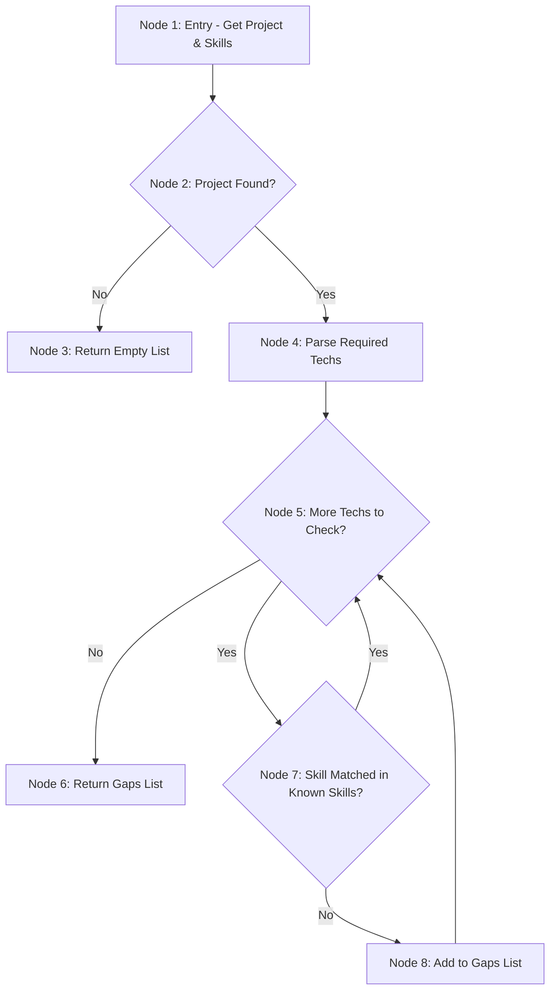

# SOFTWARE TESTING SPECIFICATION & TEST CASES
## Student Project and Skill Tracking System

---

**Institution:** Velalar College of Engineering and Technology (Autonomous), Erode - 638012  
**Department:** Department of Information Technology  
**Academic Year:** 2026 - 27 (ODD Semester) | **Class:** 25IT3A&B  
**Author / Student Name:** Abhishek.R  
**Register Number:** 732925ITR002  
**Class & Section:** 25IT3A (Section A)  
**Course Code & Title:** 25ITT33 - Software Engineering (Unit 4: Software Testing)  

---

## 1. Testing Strategy & Principles

The testing framework aligns with **Software Engineering (25ITT33) Unit 4** principles:
* **Verification:** Confirming that each development phase (SRS, UML design, DB schema, code) correctly satisfies its respective specifications.
* **Validation:** Ensuring that the operational system satisfies the intended academic tracking and analytics objectives of the IT department.

### Testing Levels Implemented
1. **Unit Testing:** Validating individual Java methods (validation constraints, marks calculation, progress percentages).
2. **Integration Testing:** Verifying communication between Java Service classes, DAOs, and the underlying SQLite database engine via JDBC.
3. **Validation Testing:** Evaluating user interaction flows, menu boundary choices, and data entry validations.
4. **System Testing:** End-to-end verification covering student registration, project lifecycle updates, evaluation scoring, and Python data visualization generation.

---

## 2. Test Design Techniques

### 2.1 Black-Box Testing Techniques

#### Technique 1: Boundary Value Analysis (BVA)
Applied to evaluation marks validation ($0.0 \le \text{Obtained Marks} \le 20.0$):
* **Min - 1:** $-0.5$ (Expected: Rejected)
* **Min:** $0.0$ (Expected: Accepted)
* **Min + 1:** $1.0$ (Expected: Accepted)
* **Nominal:** $18.5$ (Expected: Accepted)
* **Max - 1:** $19.0$ (Expected: Accepted)
* **Max:** $20.0$ (Expected: Accepted)
* **Max + 1:** $20.5$ (Expected: Rejected)

#### Technique 2: Equivalence Partitioning (EP)
Applied to student email validation:
* **Valid Class:** Strings containing username, `@`, domain, and `.tld` (e.g., `abhishek.r@vcet.ac.in`).
* **Invalid Class 1:** Missing `@` symbol (e.g., `abhishekr.vcet.ac.in` -> Rejected).
* **Invalid Class 2:** Missing domain dot (e.g., `abhishek@vcet` -> Rejected).
* **Invalid Class 3:** Empty or whitespace string (-> Rejected).

---

### 2.2 White-Box Testing Techniques

#### Basis Path Testing & Cyclomatic Complexity
Evaluated on `TrackingService.analyzeSkillGaps(int projectId)`:

* **Number of Edges ($E$):** 9  
* **Number of Nodes ($N$):** 8  
* **Cyclomatic Complexity:** $V(G) = E - N + 2 = 9 - 8 + 2 = 3$  
* **Independent Execution Paths:**
  1. **Path 1:** $1 \rightarrow 2 \rightarrow 3$ (Project not found, graceful exit)
  2. **Path 2:** $1 \rightarrow 2 \rightarrow 4 \rightarrow 5 \rightarrow 7 \rightarrow 5 \rightarrow 6$ (All technologies match student skills; zero gaps)
  3. **Path 3:** $1 \rightarrow 2 \rightarrow 4 \rightarrow 5 \rightarrow 7 \rightarrow 8 \rightarrow 5 \rightarrow 6$ (Unmatched technology detected; added to gap list)

---

## 3. Comprehensive Test Cases and Execution Results

| Test Case ID | Test Level | Module Under Test | Test Scenario Description | Input Test Data | Expected Result | Actual Result | Status |
|:---|:---|:---|:---|:---|:---|:---|:---:|
| **TC-01** | Unit | `StudentDAO` | Register valid student record | Reg: `732925ITR002`, Name: `Abhishek.R`, Email: `abhishek.r@vcet.ac.in` | Record added successfully | Record inserted into SQLite | **PASS** |
| **TC-02** | Unit (EP) | `TrackingService` | Reject student registration with invalid email format | Email: `abhishek_vcet_ac_in` | Throw `IllegalArgumentException` | Exception caught: "Invalid email format" | **PASS** |
| **TC-03** | Unit | `StudentDAO` | Reject duplicate student registration | Reg: `732925ITR002` (Already existing) | Database constraint rejection | Insert rejected (`UNIQUE constraint failed`) | **PASS** |
| **TC-04** | Unit | `StudentDAO` | Assign skill with valid proficiency | Student: `732925ITR002`, Skill: Java (ID: 1), Level: `Advanced` | Skill mapped in `student_skills` | Mapping saved successfully | **PASS** |
| **TC-05** | Unit (EP) | `TrackingService` | Reject invalid skill proficiency | Student: `732925ITR002`, Skill: 1, Level: `MasterGuru` | Throw `IllegalArgumentException` | Rejected with valid options prompt | **PASS** |
| **TC-06** | Integration | `ProjectDAO` | Register project with valid domain and student | Student: `732925ITR002`, Title: "Tracking System", Domain: `Data Science` | Project ID assigned; 5 milestones auto-created | Project ID #1 assigned; 5 milestones generated | **PASS** |
| **TC-07** | Unit (EP) | `TrackingService` | Reject project with unapproved domain | Domain: `Quantum Teleportation` | Throw `IllegalArgumentException` | Exception caught: "Invalid domain" | **PASS** |
| **TC-08** | Unit (BVA) | `TrackingService` | Log evaluation mark at nominal boundary | Marks: `19.5`, Max: `20.0`, Comp: `Review 1` | Evaluation stored | Score logged; total score updated | **PASS** |
| **TC-09** | Unit (BVA) | `TrackingService` | Reject evaluation mark below lower boundary | Marks: `-2.0`, Max: `20.0` | Validation error; record rejected | Rejected: Marks must be between 0 and 20 | **PASS** |
| **TC-10** | Unit (BVA) | `TrackingService` | Reject evaluation mark above upper boundary | Marks: `22.5`, Max: `20.0` | Validation error; record rejected | Rejected: Marks must be between 0 and 20 | **PASS** |
| **TC-11** | Unit | `Project` | Calculate project milestone completion percentage | 5 milestones total, 5 marked `Completed` | Completion = $100.0\%$ | Returns $100.0\%$ | **PASS** |
| **TC-12** | Unit | `Project` | Calculate project partial milestone completion | 4 milestones total, 3 marked `Completed` | Completion = $75.0\%$ | Returns $75.0\%$ | **PASS** |
| **TC-13** | Logic | `TrackingService` | Flag skill gaps when student lacks project tech | Project requires `Matplotlib`; student has `Java, Python, SQL` | Flag `Matplotlib` as skill gap | Flagged: `Matplotlib (No verified proficiency)` | **PASS** |
| **TC-14** | Integration | `ProjectDAO` | Filter projects by domain | Filter keyword: `Web Development` | Returns only Web Development projects | Exactly 3 Web projects returned | **PASS** |
| **TC-15** | Integration | `ProjectDAO` | Filter projects by lifecycle status | Filter keyword: `Completed` | Returns only Completed projects | Exactly 5 Completed projects returned | **PASS** |
| **TC-16** | System | `setup_database.py` | Create relational schema and populate seed data | Execute `schema.sql` and `seed_data.sql` | 6 tables created, 12 students, 12 projects | All tables created; 0 errors | **PASS** |
| **TC-17** | System | `data_retrieval.py` | Extract SQLite records into preprocessed CSV files | Execute query pipeline | 3 clean CSVs generated (`projects`, `skills`, `evals`) | CSVs generated with full headers | **PASS** |
| **TC-18** | System | `generate_vis.py` | Generate 4 publication charts via Matplotlib | Render 4 figure layouts to PNG | 4 high-res PNG files created in `visualizations/` | 4 PNG files generated and verified | **PASS** |
| **TC-19** | System | `Main.java` | Execute non-interactive automated test demo | CLI arg `--demo` | Displays full student table, projects, dossier, and dashboard | Output rendered with 100% success | **PASS** |

---

## 4. Test Summary & Quality Sign-Off

* **Total Test Cases Executed:** 19
* **Passed:** 19 (100.0%)
* **Failed:** 0 (0.0%)
* **Test Coverage:** All 7 Functional Requirements (FR-01 to FR-07) and boundary conditions validated.
* **Faculty Review Recommendation:** System meets all quality metrics for academic deployment and evaluation.
